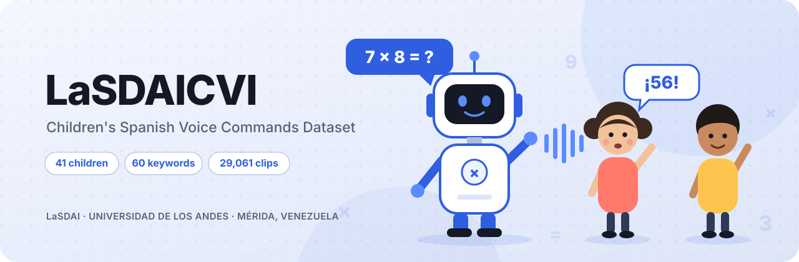

<p align="center">
  
</p>

# LaSDAICVI — Children's Spanish Voice Commands Dataset

[](https://creativecommons.org/licenses/by-nc/4.0/)
[](docs/thesis.pdf)
[](https://drive.google.com/file/d/1I3tcatIgjIvYA8dBpTm-qJYd0IevwYsq/view?usp=sharing)
[](https://doi.org/10.13140/RG.2.2.27502.95042)

**LaSDAICVI** (*LaSDAI Comandos de Voz Infantil*) is a keyword-spotting dataset of **Spanish speech recorded from children aged 8 to 11**. It contains **29,061 isolated-word recordings** of **60 keywords** (digits, multiplication-table results and short voice commands) spoken by **41 primary-school children** in Mérida, Venezuela.

Children's speech differs from adult speech in pitch, formants, speaking rate and pronunciation variability, and public corpora of children speaking Spanish are scarce. LaSDAICVI was built to train and evaluate keyword-spotting models for a social robot that helps children practice their multiplication tables by answering out loud.

The dataset was created at the **Laboratorio de Sistemas Discretos, Automatización e Integración (LaSDAI)** of the **Universidad de los Andes (ULA)**, Mérida, Venezuela, as part of the B.Sc. thesis listed in [Citation](#citation).

## At a glance

| | |
|---|---|
| Language | Spanish (Venezuela) |
| Task | Keyword spotting / isolated-word recognition |
| Speakers | 41 children: 22 girls, 19 boys |
| Age | 8–11 years (mean 9.61, SD 1.07) |
| School grade | 3rd to 6th grade of primary school |
| Keywords | 60 |
| Recordings | 29,061 keyword samples + 12 background-noise clips |
| Samples per keyword | 444–537 |
| Audio format | WAV, 16 kHz, mono, 16-bit PCM |
| Total size | ~890 MB |

## Vocabulary

The 60 keywords cover three groups, chosen so that a child can answer multiplication questions and control an interactive application by voice.

| Group | Count | Keywords |
|---|---|---|
| Digits | 10 | `0` `1` `2` `3` `4` `5` `6` `7` `8` `9` |
| Multiplication-table results (tables 2–9) | 32 | `10` `12` `14` `15` `16` `18` `20` `21` `24` `25` `27` `28` `30` `32` `35` `36` `40` `42` `45` `48` `49` `50` `54` `56` `60` `63` `64` `70` `72` `80` `81` `90` |
| Commands | 18 | `abajo` `actívate` `apágate` `aprender` `arriba` `atrás` `continúa` `derecha` `detente` `falso` `izquierda` `jugar` `no` `pepe` `repite` `si` `siguiente` `verdadero` |

`pepe` is the wake word of the robot used in the project.

<details>
<summary>Samples per keyword</summary>

| Keyword | Samples | Keyword | Samples | Keyword | Samples |
|---|---:|---|---:|---|---:|
| `0` | 504 | `27` | 501 | `81` | 494 |
| `1` | 482 | `28` | 495 | `90` | 487 |
| `2` | 481 | `30` | 490 | `abajo` | 466 |
| `3` | 481 | `32` | 506 | `actívate` | 486 |
| `4` | 479 | `35` | 504 | `aprender` | 503 |
| `5` | 493 | `36` | 498 | `apágate` | 465 |
| `6` | 483 | `40` | 475 | `arriba` | 481 |
| `7` | 472 | `42` | 483 | `atrás` | 457 |
| `8` | 497 | `45` | 475 | `continúa` | 487 |
| `9` | 472 | `48` | 463 | `derecha` | 461 |
| `10` | 444 | `49` | 478 | `detente` | 472 |
| `12` | 472 | `50` | 466 | `falso` | 478 |
| `14` | 505 | `54` | 494 | `izquierda` | 481 |
| `15` | 494 | `56` | 491 | `jugar` | 501 |
| `16` | 487 | `60` | 498 | `no` | 461 |
| `18` | 491 | `63` | 486 | `pepe` | 467 |
| `20` | 474 | `64` | 500 | `repite` | 508 |
| `21` | 469 | `70` | 495 | `si` | 469 |
| `24` | 492 | `72` | 537 | `siguiente` | 462 |
| `25` | 499 | `80` | 483 | `verdadero` | 486 |

</details>

## Repository structure

```text
.
├── LaSDAICVI/
│   ├── 0/                  # one folder per keyword
│   │   ├── 2d5ywQE8_F_9_3_1.wav
│   │   └── ...
│   ├── 1/
│   ├── ...
│   ├── verdadero/
│   └── _ruido_/            # background noise for data augmentation
│       ├── *.wav           # 8 clips for training
│       └── Test/           # 4 clips for evaluation
├── lasdaicvi.csv           # metadata, one row per keyword sample
├── splits/
│   ├── train.csv           # 21 speakers
│   ├── validation.csv      # 10 speakers
│   └── test.csv            # 10 speakers
├── assets/banner.svg      # README illustration
├── docs/thesis.pdf        # full B.Sc. thesis (Spanish)
├── LICENSE
├── CITATION.cff
└── README.md
```

### File naming

Each recording is named:

```text
{id}_{gender}_{age}_{grade}_{sample}.wav
```

| Field | Description | Example |
|---|---|---|
| `id` | Random 8-character speaker identifier | `2d5ywQE8` |
| `gender` | `F` (girl) or `M` (boy) | `F` |
| `age` | Age in years | `9` |
| `grade` | Primary-school grade | `3` |
| `sample` | Repetition number for that speaker and keyword | `1` |

So `LaSDAICVI/0/2d5ywQE8_F_9_3_1.wav` is the first recording of the keyword **0** by speaker `2d5ywQE8`, a 9-year-old girl in 3rd grade.

### Metadata

`lasdaicvi.csv` has one row per keyword sample:

| Column | Description |
|---|---|
| `path` | Path relative to `LaSDAICVI/` |
| `filename` | File name |
| `id` | Speaker identifier |
| `gender` | `F` or `M` |
| `age` | Age in years |
| `grade` | School grade |
| `sample` | Repetition number |
| `label` | Keyword (matches the folder name) |

```python
import pandas as pd

df = pd.read_csv("lasdaicvi.csv")
df["filepath"] = "LaSDAICVI/" + df["path"]
print(df.groupby("label").size())
```

## Data collection

- **Participants.** 41 children enrolled in 3rd to 6th grade of primary school. Parents or legal guardians signed an informed consent form, and each child gave informed assent before recording. Each child received a random identifier; no names are stored.
- **Setup.** Recordings were made in a quiet room with a condenser microphone placed 30 cm from the child and connected to a laptop running Audacity. Audio is stored as 16 kHz, mono, 16-bit PCM WAV.
- **Protocol.** Each child completed two sessions of up to 25 minutes, separated by a 10-minute break with a snack. Each keyword was first shown on screen and played as audio, and the child repeated it. Numbers were shown in random order. Every session covered five repetitions of the full vocabulary, giving at least 10 samples per child and keyword. Short breaks every 42 numbers and every 18 commands prevented fatigue. Mispronounced or noisy takes were repeated.
- **Labeling.** Every recording was manually trimmed and labeled in Audacity. Ambiguous pronunciations and samples with loud noise were discarded.

## Train, validation and test splits

To measure how well a model generalizes to **new children**, the data must be split by speaker, never by file. `splits/` contains the speaker-independent split used in the thesis: within each grade and gender, about 50% of the children went to training, 25% to validation and 25% to testing. No child appears in more than one split, and the three files together cover every sample.

| Split | Speakers | Samples |
|---|---:|---:|
| `train.csv` | 21 | 14,737 |
| `validation.csv` | 10 | 7,210 |
| `test.csv` | 10 | 7,114 |

The speaker lists match Tables 3.10–3.12 of the thesis. The thesis reports 7,113 test samples, one fewer than the released files contain.

Each file has the same columns as `lasdaicvi.csv`, with `path` relative to `LaSDAICVI/`. Use this split to compare results with the thesis.

```python
import pandas as pd

splits = {s: pd.read_csv(f"splits/{s}.csv") for s in ("train", "validation", "test")}
train = splits["train"].assign(filepath=lambda d: "LaSDAICVI/" + d["path"])
```

## Data augmentation and baselines

The `_ruido_/` clips are classroom, corridor and playground recordings that can be mixed into training samples to make models robust to school noise. Mix the 8 top-level clips into training data and keep the 4 clips in `_ruido_/Test/` for evaluation. The thesis also applied speed perturbation with a factor drawn uniformly from 0.85–1.15, and compared CNN, GRU-based RNN and CRNN architectures on MFCC features.

## Ethics and responsible use

These are recordings of **minors**. By using the dataset you agree to:

- Use it for **non-commercial research and education** only, as the license requires.
- **Not attempt to identify** any participant, or to link recordings to other data about them.
- **Not use** the recordings for speaker identification, voice cloning, voice synthesis or any other use that could harm the children who took part.
- Not redistribute modified recordings in a way that misrepresents what a child said.

If you believe a recording should be removed, please [open an issue](../../issues).

## License

The children's recordings, the metadata and the splits are released under the [Creative Commons Attribution-NonCommercial 4.0 International (CC BY-NC 4.0)](https://creativecommons.org/licenses/by-nc/4.0/) license. You may share and adapt them for non-commercial purposes, as long as you give appropriate credit by citing the work below. See [LICENSE](LICENSE).

### Third-party background noise

The clips in `_ruido_/` are **not** part of the original recordings. They come from [Freesound](https://freesound.org), stored as 16 kHz mono WAV, and keep their original licenses:

| File | Author | License |
|---|---|---|
| [`classroom_135776`](https://freesound.org/s/135776/) | nickpursehouse | CC0 1.0 |
| [`classroom_166207`](https://freesound.org/s/166207/) | abcopen | CC BY-NC 3.0 |
| [`classroom_196750`](https://freesound.org/s/196750/) | hutsvoid | CC BY-NC 4.0 |
| [`classroom_450728`](https://freesound.org/s/450728/) | kyles | CC0 1.0 |
| [`corridors_148814`](https://freesound.org/s/148814/) | vetter-balin | CC0 1.0 |
| [`corridors_495805`](https://freesound.org/s/495805/) | fthgurdy | CC0 1.0 |
| [`playground_417551`](https://freesound.org/s/417551/) | rui-aires | CC0 1.0 |
| [`playground_426479`](https://freesound.org/s/426479/) | nickmed401 | CC0 1.0 |
| [`Test/classroom_469489`](https://freesound.org/s/469489/) | rucisko | CC0 1.0 |
| [`Test/classroom_506446`](https://freesound.org/s/506446/) | dr-macak | CC0 1.0 |
| [`Test/corridors_61051`](https://freesound.org/s/61051/) | morgantj | CC BY 4.0 |
| [`Test/playground_213350`](https://freesound.org/s/213350/) | mycompasstv | CC0 1.0 |

## Citation

If you use LaSDAICVI, please cite the thesis in which it was created. The thesis is written in Spanish; its title translates to *Design of Human-Robot Interaction for Learning Multiplication Tables and Implementation of Speech Recognition Models*. The full text is available in [`docs/thesis.pdf`](docs/thesis.pdf).

```bibtex
@thesis{carrillo2021lasdaicvi,
  author      = {Carrillo, Gilberto},
  title       = {Dise{\~n}o de interacci{\'o}n humano-robot para el aprendizaje de las tablas de multiplicaci{\'o}n e implementaci{\'o}n de los modelos de reconocimiento del habla},
  type        = {B.Sc. thesis},
  institution = {Universidad de los Andes},
  address     = {M{\'e}rida, Venezuela},
  year        = {2021},
  doi         = {10.13140/RG.2.2.27502.95042}
}
```

The thesis won **2nd place** in the VII National Contest of Special Degree Projects of the Venezuelan Computing Society ([view certificate](https://drive.google.com/file/d/1I3tcatIgjIvYA8dBpTm-qJYd0IevwYsq/view?usp=sharing)).

## Acknowledgments

- **Advisor:** Dr. Jesús Alberto Pérez Angulo, Associate Professor, School of Systems Engineering, Universidad de los Andes, and researcher at LaSDAI.
- **LaSDAI**, Laboratorio de Sistemas Discretos, Automatización e Integración, Universidad de los Andes, Mérida, Venezuela.
- The schools, teachers and families who made the recordings possible, and above all the **children** who lent their voices.

## Author

**Gilberto Carrillo** · [gilbertocarrillo.com](https://gilbertocarrillo.com) · [GitHub](https://github.com/gilbertocarrillo)
