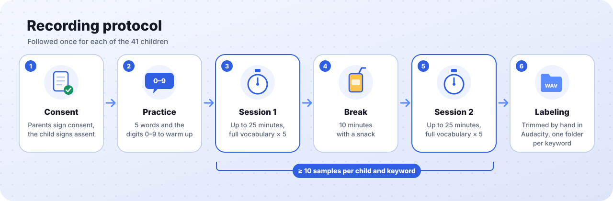
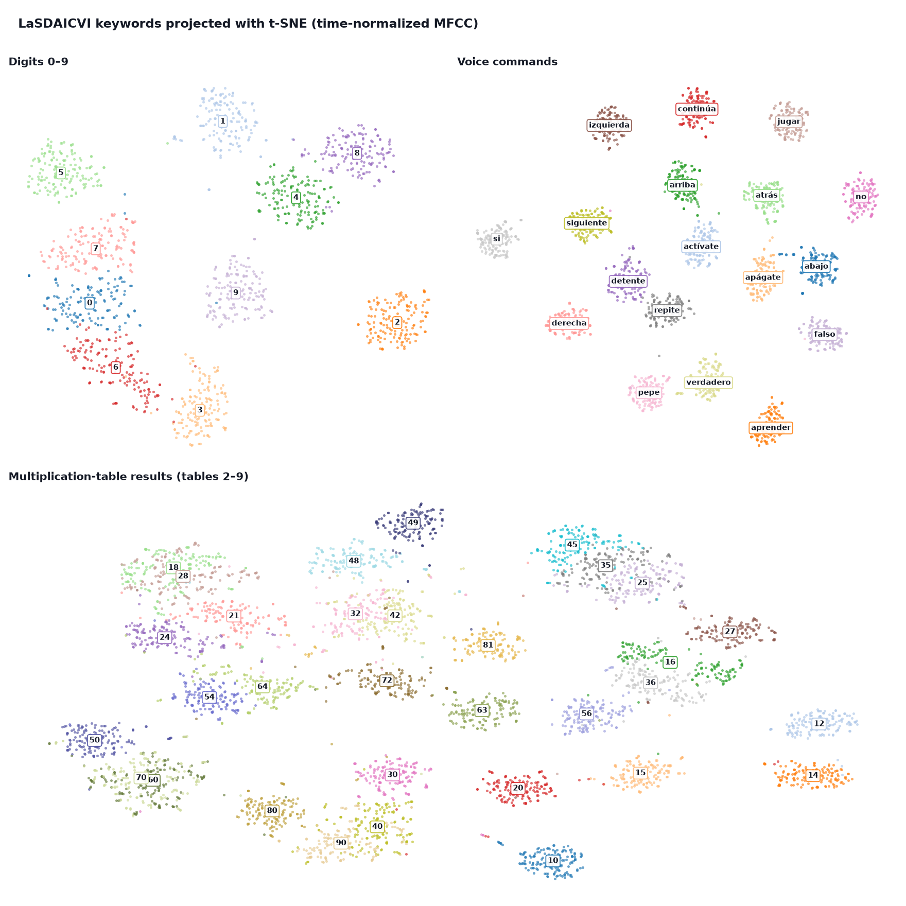
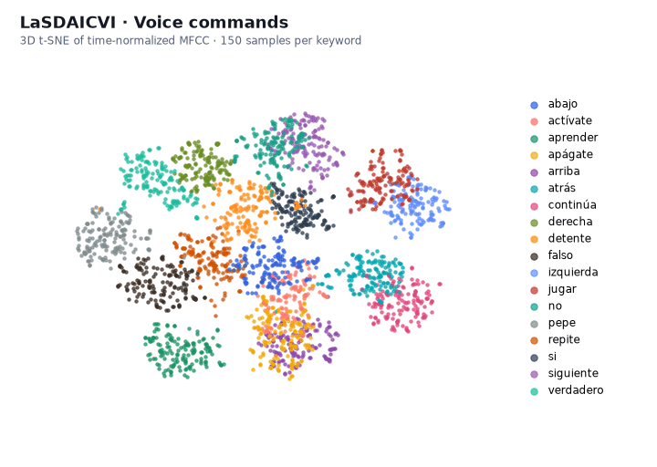

<p align="center">
  
</p>

# LaSDAICVI — Children's Spanish Voice Commands Dataset

[](https://doi.org/10.5281/zenodo.24430509)
[](https://huggingface.co/datasets/gilbertocp93/LaSDAICVI)
[](https://creativecommons.org/licenses/by-nc/4.0/)
[](docs/thesis.pdf)
[](https://drive.google.com/file/d/1I3tcatIgjIvYA8dBpTm-qJYd0IevwYsq/view?usp=sharing)
[](https://doi.org/10.13140/RG.2.2.27502.95042)

**LaSDAICVI** (*LaSDAI Comandos de Voz Infantil*) is a keyword-spotting dataset of **Spanish speech recorded from children aged 8 to 11**. It contains **29,061 isolated-word recordings** of **60 keywords** (digits, multiplication-table results and short voice commands) spoken by **41 primary-school children** from Tucaní, Mérida state, Venezuela.

Children's speech differs from adult speech in pitch, formants, speaking rate and pronunciation variability, and public corpora of children speaking Spanish are scarce. At the time of the thesis, LaSDAICVI was, to the author's knowledge, the first children's speech corpus in Spanish built for keyword spotting. It was built to train and evaluate keyword-spotting models for a social robot that helps children practice their multiplication tables by answering out loud.

The dataset was created at the **Laboratorio de Sistemas Discretos, Automatización e Integración (LaSDAI)** of the **Universidad de los Andes (ULA)**, Mérida, Venezuela, as part of the B.Sc. thesis listed in [Citation](#citation).

## At a glance

| | |
|---|---|
| Language | Spanish (Venezuela) |
| Task | Keyword spotting / isolated-word recognition |
| Speakers | 41 children: 22 girls, 19 boys |
| Age | 8–11 years (mean 9.61, SD 1.07) |
| School grade | 3rd to 6th grade of primary school |
| Keywords | 60 |
| Recordings | 29,061 keyword samples + 12 background-noise clips |
| Samples per keyword | 444–537 |
| Audio format | WAV, 16 kHz, mono, 16-bit PCM |
| Total size | ~890 MB |

## Vocabulary

The 60 keywords cover three groups, chosen so that a child can answer multiplication questions and control an interactive application by voice.

| Group | Count | Keywords |
|---|---|---|
| Digits | 10 | `0` `1` `2` `3` `4` `5` `6` `7` `8` `9` |
| Multiplication-table results (tables 2–9) | 32 | `10` `12` `14` `15` `16` `18` `20` `21` `24` `25` `27` `28` `30` `32` `35` `36` `40` `42` `45` `48` `49` `50` `54` `56` `60` `63` `64` `70` `72` `80` `81` `90` |
| Commands | 18 | `abajo` `actívate` `apágate` `aprender` `arriba` `atrás` `continúa` `derecha` `detente` `falso` `izquierda` `jugar` `no` `pepe` `repite` `si` `siguiente` `verdadero` |

`pepe` is the name and wake word of the robot used in the project. The commands were inspired by the adult [Speech Commands](https://arxiv.org/abs/1804.03209) dataset.

<details>
<summary>Samples per keyword</summary>

| Keyword | Samples | Keyword | Samples | Keyword | Samples |
|---|---:|---|---:|---|---:|
| `0` | 504 | `27` | 501 | `81` | 494 |
| `1` | 482 | `28` | 495 | `90` | 487 |
| `2` | 481 | `30` | 490 | `abajo` | 466 |
| `3` | 481 | `32` | 506 | `actívate` | 486 |
| `4` | 479 | `35` | 504 | `aprender` | 503 |
| `5` | 493 | `36` | 498 | `apágate` | 465 |
| `6` | 483 | `40` | 475 | `arriba` | 481 |
| `7` | 472 | `42` | 483 | `atrás` | 457 |
| `8` | 497 | `45` | 475 | `continúa` | 487 |
| `9` | 472 | `48` | 463 | `derecha` | 461 |
| `10` | 444 | `49` | 478 | `detente` | 472 |
| `12` | 472 | `50` | 466 | `falso` | 478 |
| `14` | 505 | `54` | 494 | `izquierda` | 481 |
| `15` | 494 | `56` | 491 | `jugar` | 501 |
| `16` | 487 | `60` | 498 | `no` | 461 |
| `18` | 491 | `63` | 486 | `pepe` | 467 |
| `20` | 474 | `64` | 500 | `repite` | 508 |
| `21` | 469 | `70` | 495 | `si` | 469 |
| `24` | 492 | `72` | 537 | `siguiente` | 462 |
| `25` | 499 | `80` | 483 | `verdadero` | 486 |

</details>

## Repository structure

```text
.
├── LaSDAICVI/
│   ├── 0/                  # one folder per keyword
│   │   ├── 2d5ywQE8_F_9_3_1.wav
│   │   └── ...
│   ├── 1/
│   ├── ...
│   ├── verdadero/
│   └── _ruido_/            # background noise for data augmentation
│       ├── *.wav           # 8 clips for training
│       └── Test/           # 4 clips for evaluation
├── lasdaicvi.csv           # metadata, one row per keyword sample
├── splits/
│   ├── train.csv           # 21 speakers
│   ├── validation.csv      # 10 speakers
│   └── test.csv            # 10 speakers
├── training/              # code to train the thesis models (see training/README.md)
├── assets/                # README illustrations
├── docs/thesis.pdf        # full B.Sc. thesis (Spanish)
├── scripts/               # analysis scripts
├── LICENSE
├── CITATION.cff
└── README.md
```

### File naming

Each recording is named:

```text
{id}_{gender}_{age}_{grade}_{sample}.wav
```

| Field | Description | Example |
|---|---|---|
| `id` | Random 8-character speaker identifier | `2d5ywQE8` |
| `gender` | `F` (girl) or `M` (boy) | `F` |
| `age` | Age in years | `9` |
| `grade` | Primary-school grade | `3` |
| `sample` | Repetition number for that speaker and keyword | `1` |

So `LaSDAICVI/0/2d5ywQE8_F_9_3_1.wav` is the first recording of the keyword **0** by speaker `2d5ywQE8`, a 9-year-old girl in 3rd grade.

### Metadata

`lasdaicvi.csv` has one row per keyword sample:

| Column | Description |
|---|---|
| `path` | Path relative to `LaSDAICVI/` |
| `filename` | File name |
| `id` | Speaker identifier |
| `gender` | `F` or `M` |
| `age` | Age in years |
| `grade` | School grade |
| `sample` | Repetition number |
| `label` | Keyword (matches the folder name) |

```python
import pandas as pd

df = pd.read_csv("lasdaicvi.csv")
df["filepath"] = "LaSDAICVI/" + df["path"]
print(df.groupby("label").size())
```

## Data collection

### Participants

41 children enrolled in 3rd to 6th grade of primary schools in Tucaní, Mérida state, Venezuela. Their parents signed an informed consent form, and each child signed an informed assent before recording. Each child received a random identifier; no names are stored in the dataset.

| Grade | Girls | Boys | Total |
|---|---:|---:|---:|
| 3rd | 5 | 5 | 10 |
| 4th | 6 | 5 | 11 |
| 5th | 7 | 5 | 12 |
| 6th | 4 | 4 | 8 |
| **Total** | **22** | **19** | **41** |

### Recording setup

<p align="center">
  
</p>

Speech was recorded in a quiet room at 16 kHz, 32-bit, mono, with a condenser microphone placed 30 cm from the child and connected to a laptop running Audacity. A second laptop drove a monitor that showed each keyword on a slide, together with a 2D animation of the robot Pepe. The child heard the keyword through headphones, so the prompt did not leak into the recording.

### Protocol

<p align="center">
  
</p>

1. The experimenter explained the session, the child signed the assent form, and a short practice round with 5 words and the digits 0–9 helped nervous children get familiar with the process.
2. Each child completed two sessions of up to 25 minutes, separated by a 10-minute break with a snack.
3. In each session the child repeated the full vocabulary 5 times, giving at least 10 samples per child and keyword. Numbers were presented in random order, with short breaks every 42 numbers and every 18 commands to avoid fatigue.
4. A take was repeated if the child mispronounced the word, loud noise was captured, or the child or experimenter was not satisfied with it.

### Labeling

An experimenter manually trimmed and labeled every recording in Audacity, discarding ambiguous pronunciations and samples with loud noise. Each sample was saved as a 16-bit PCM WAV file in a folder named after its keyword.

### Notes on the thesis text

- Section 3.2.5 of the thesis describes the file name as `{ID}_{AGE}_{GENDER}_{GRADE}_{#}`, but the released files put gender before age, as documented in [File naming](#file-naming).
- Table 3.8 of the thesis swaps the sample counts of `aprender` (503) and `jugar` (501). The other 58 counts match the released files.

## Train, validation and test splits

To measure how well a model generalizes to **new children**, the data must be split by speaker, never by file. `splits/` contains the speaker-independent split used in the thesis: within each grade and gender, about 50% of the children went to training, 25% to validation and 25% to testing. No child appears in more than one split, and the three files together cover every sample.

| Split | Speakers | Samples |
|---|---:|---:|
| `train.csv` | 21 | 14,737 |
| `validation.csv` | 10 | 7,210 |
| `test.csv` | 10 | 7,114 |

The speaker lists match Tables 3.10–3.12 of the thesis. The thesis reports 7,113 test samples, one fewer than the released files contain.

Each file has the same columns as `lasdaicvi.csv`, with `path` relative to `LaSDAICVI/`. Use this split to compare results with the thesis.

```python
import pandas as pd

splits = {s: pd.read_csv(f"splits/{s}.csv") for s in ("train", "validation", "test")}
train = splits["train"].assign(filepath=lambda d: "LaSDAICVI/" + d["path"])
```

## Data augmentation and training

The `_ruido_/` clips are classroom, corridor and playground recordings that can be mixed into samples to make models robust to school noise. The 8 top-level clips were used for training and the 4 clips in `_ruido_/Test/` for testing, so that no noise recording leaks between the two.

The thesis pipeline was:

- **Speed perturbation:** 6 copies of each training sample, with a speed factor drawn uniformly from [0.85, 1.15], because children vary more in speaking rate than adults.
- **Background noise:** each sample mixed, with probability 0.8 in the training notebooks, with a noise clip at a signal-to-noise ratio drawn uniformly from [5, 30] dB.
- **Fixed length:** each sample placed at a random position inside 2 seconds of silence, plus extra silent samples labeled as silence.
- **Features:** 20 MFCCs from 1024-sample windows (64 ms) with a 512-sample hop (32 ms) and 40 mel filters, giving a 61 × 20 matrix per sample.
- **Models:** CNN, GRU-based RNN and CRNN, with hyperparameters taken from prior work on the Speech Commands dataset.

Training used Keras with a batch size of 128, Adam with a learning rate of 10⁻⁵ and 300–400 epochs, keeping the checkpoint with the lowest validation loss. See Chapters 3 and 4 of the [thesis](docs/thesis.pdf) for the per-model results, plus the [class distribution of each model's datasets](https://docs.google.com/document/d/1QcDFi-XvZFab0Ma7n_YCGwCVCHsd-nQKETbPuG1NvRM/edit?usp=sharing) and the [learning curves](https://docs.google.com/document/d/1cJVV6Lwy9QlAGqqyMlAM9Qp7WvbFz0df7RbJ5iBsOFU/edit?usp=sharing).

### Training code

[`training/`](training/) contains the thesis training pipeline, rewritten from the original notebooks as one documented Python package. A single command trains any of the 60 models of Table 4.1:

```bash
cd training
uv sync
uv run lasdaicvi-train --task interaction --arch gru --aug
```

By default it fixes three small bugs of the original notebooks; `--thesis` replays them to match the published numbers. See [`training/README.md`](training/README.md) for installation, every option and the validation against the thesis.

The 60 trained models of the thesis (Keras, TensorFlow Lite and the original weights) are on Hugging Face: [gilbertocp93/LaSDAICVI-models](https://huggingface.co/gilbertocp93/LaSDAICVI-models), gated under the same terms as the dataset.

## Do the keywords sound different?

Each point below is one recording, placed with t-SNE according to its time-normalized MFCC trajectory. t-SNE keeps local neighborhoods but not global distances, so only the grouping matters, not the space between clouds.

<p align="center">
  
</p>

- **Digits and commands** form one clean cloud per keyword, even for similar words such as `arriba` and `abajo`.
- **Most multiplication-table results** separate too, such as `10`, `12`, `14`, `20`, `49` and `81`.
- **Some numbers overlap** because they sound alike: `60` and `70` (*sesenta*, *setenta*), `18` and `28` (*dieciocho*, *veintiocho*), `25`, `35` and `45` (all ending in *…y cinco*), and `40` and `90` (*cuarenta*, *noventa*). These are the hard cases for a model, and the reason the thesis models treat similar-sounding numbers as explicit "unknown" words.

The voice commands in 3D:

<p align="center">
  
</p>

Both figures use 150 random samples per keyword and can be reproduced with [uv](https://docs.astral.sh/uv/):

```bash
uv run scripts/plot_keyword_clusters.py
uv run scripts/plot_keyword_clusters_3d.py
```

## Baseline results

The thesis trained **10 keyword-spotting models** on the [official splits](#train-validation-and-test-splits) instead of one 60-class model: one per multiplication table (2 to 9), one for the interaction commands and one for the wake word `pepe`. Each model also recognizes *silence* and *unknown*, where *unknown* includes similar-sounding numbers from other tables.

Best test accuracy per model, all trained with data augmentation (Table 4.1 of the thesis):

| Model | Best architecture | Clean test | Noisy test |
|---|---|---:|---:|
| Table of 2 | CRNN | 97.86% | 96.33% |
| Table of 3 | GRU | 97.19% | 94.52% |
| Table of 4 | GRU | 97.22% | 95.00% |
| Table of 5 | GRU | 97.79% | 95.02% |
| Table of 6 | GRU | 97.90% | 95.12% |
| Table of 7 | GRU | 97.25% | 94.65% |
| Table of 8 | CRNN | 96.87% | 94.08% |
| Table of 9 | GRU | 96.12% | 93.13% |
| Interaction commands | GRU | 98.33% | 96.86% |
| Wake word (`pepe`) | GRU | **99.38%** | **97.82%** |

Data augmentation is what makes the models robust to school noise. Without it, the same models drop to roughly 30–62% accuracy on the noisy test set. The thesis reports the full results for CNN, GRU and CRNN, plus precision, recall, F1 and confusion matrices for every model.

The [training code](#training-code) was checked against these results in two ways: the 60 original trained models ([on Hugging Face](https://huggingface.co/gilbertocp93/LaSDAICVI-models)) reproduce the clean and noisy accuracy of Table 4.1 exactly, and five of the rows retrained from scratch land close to it (within 0.6 points clean on four of them; see the [validation table](training/README.md#validation-against-the-thesis)).

## Limitations

Know these before drawing conclusions from results on LaSDAICVI:

- **One region, one accent.** All 41 children come from primary schools in Tucaní, Mérida state, so the recordings reflect the Venezuelan Spanish of a single locality. Models trained on this data may not transfer to other Spanish varieties.
- **A narrow age range.** Speakers are 8 to 11 years old (3rd to 6th grade). Younger children, whose speech differs more from adult speech, are not represented.
- **Prompted, isolated words.** Each child repeated a word right after hearing it through headphones, and every sample was trimmed to a single word. This is cleaner than spontaneous speech: the thesis notes that in real interactions children swap phonemes, mispronounce words and use invented words, which increases recognition errors.
- **Controlled recording conditions.** All audio comes from one condenser microphone 30 cm away in a quiet room. Real classrooms and robot microphones are noisier and less predictable; the 12 background-noise clips only partly simulate this, and the thesis recommends using the models in conditions similar to the training ones.
- **Small evaluation sets.** The validation and test splits have 10 children each, so results can shift noticeably depending on which children are held out. For more stable estimates, consider cross-validation across speakers.
- **Similar-sounding numbers.** Short numbers and pairs such as `60`/`70` or `25`/`35`/`45` are acoustically close (see the [cluster plots](#do-the-keywords-sound-different)). The thesis attributes most of its multiplication-table errors to these similarities and to the short duration of some numbers.
- **Offline baselines only.** The [baseline results](#baseline-results) were measured on held-out recordings, not in a live interaction with a robot; deploying them on a social robot and testing the interaction with children was left as future work. The [training code](#training-code) is included, and the trained models are on [Hugging Face](https://huggingface.co/gilbertocp93/LaSDAICVI-models).

## Ethics and responsible use

These are recordings of **minors**. By using the dataset you agree to:

- Use it for **non-commercial research and education** only, as the license requires.
- **Not attempt to identify** any participant, or to link recordings to other data about them.
- **Not use** the recordings for speaker identification, voice cloning, voice synthesis or any other use that could harm the children who took part.
- Not redistribute modified recordings in a way that misrepresents what a child said.

If you believe a recording should be removed, please [open an issue](../../issues).

## License

The children's recordings, the metadata and the splits are released under the [Creative Commons Attribution-NonCommercial 4.0 International (CC BY-NC 4.0)](https://creativecommons.org/licenses/by-nc/4.0/) license. You may share and adapt them for non-commercial purposes, as long as you give appropriate credit by citing the work below. See [LICENSE](LICENSE).

### Third-party background noise

The clips in `_ruido_/` are **not** part of the original recordings. They come from [Freesound](https://freesound.org), stored as 16 kHz mono WAV, and keep their original licenses:

| File | Author | License |
|---|---|---|
| [`classroom_135776`](https://freesound.org/s/135776/) | nickpursehouse | CC0 1.0 |
| [`classroom_166207`](https://freesound.org/s/166207/) | abcopen | CC BY-NC 3.0 |
| [`classroom_196750`](https://freesound.org/s/196750/) | hutsvoid | CC BY-NC 4.0 |
| [`classroom_450728`](https://freesound.org/s/450728/) | kyles | CC0 1.0 |
| [`corridors_148814`](https://freesound.org/s/148814/) | vetter-balin | CC0 1.0 |
| [`corridors_495805`](https://freesound.org/s/495805/) | fthgurdy | CC0 1.0 |
| [`playground_417551`](https://freesound.org/s/417551/) | rui-aires | CC0 1.0 |
| [`playground_426479`](https://freesound.org/s/426479/) | nickmed401 | CC0 1.0 |
| [`Test/classroom_469489`](https://freesound.org/s/469489/) | rucisko | CC0 1.0 |
| [`Test/classroom_506446`](https://freesound.org/s/506446/) | dr-macak | CC0 1.0 |
| [`Test/corridors_61051`](https://freesound.org/s/61051/) | morgantj | CC BY 4.0 |
| [`Test/playground_213350`](https://freesound.org/s/213350/) | mycompasstv | CC0 1.0 |

## Citation

If you use LaSDAICVI, please cite **both the dataset and the thesis** that describes it.

**Dataset** (archived on [Zenodo](https://doi.org/10.5281/zenodo.24430509); this DOI always resolves to the latest version):

```bibtex
@dataset{carrillo2026lasdaicvi,
  author    = {Carrillo, Gilberto},
  title     = {LaSDAICVI: Children's Spanish Voice Commands Dataset},
  publisher = {Zenodo},
  year      = {2026},
  doi       = {10.5281/zenodo.24430509}
}
```

**Thesis** (in Spanish; the title translates to *Design of Human-Robot Interaction for Learning Multiplication Tables and Implementation of Speech Recognition Models*). The full text is in [`docs/thesis.pdf`](docs/thesis.pdf).

```bibtex
@thesis{carrillo2021lasdaicvi,
  author      = {Carrillo, Gilberto},
  title       = {Dise{\~n}o de interacci{\'o}n humano-robot para el aprendizaje de las tablas de multiplicaci{\'o}n e implementaci{\'o}n de los modelos de reconocimiento del habla},
  type        = {B.Sc. thesis},
  institution = {Universidad de los Andes},
  address     = {M{\'e}rida, Venezuela},
  year        = {2021},
  doi         = {10.13140/RG.2.2.27502.95042}
}
```

The thesis won **2nd place** in the VII National Contest of Special Degree Projects of the Venezuelan Computing Society ([view certificate](https://drive.google.com/file/d/1I3tcatIgjIvYA8dBpTm-qJYd0IevwYsq/view?usp=sharing)).

## Acknowledgments

- **Advisor:** Dr. Jesús Alberto Pérez Angulo, Associate Professor, School of Systems Engineering, Universidad de los Andes, and researcher at LaSDAI.
- **LaSDAI**, Laboratorio de Sistemas Discretos, Automatización e Integración, Universidad de los Andes, Mérida, Venezuela.
- The schools, teachers and families who made the recordings possible, and above all the **children** who lent their voices.

## Author

**Gilberto Carrillo** · [gilbertocarrillo.com](https://gilbertocarrillo.com) · [GitHub](https://github.com/gilbertocarrillo)
